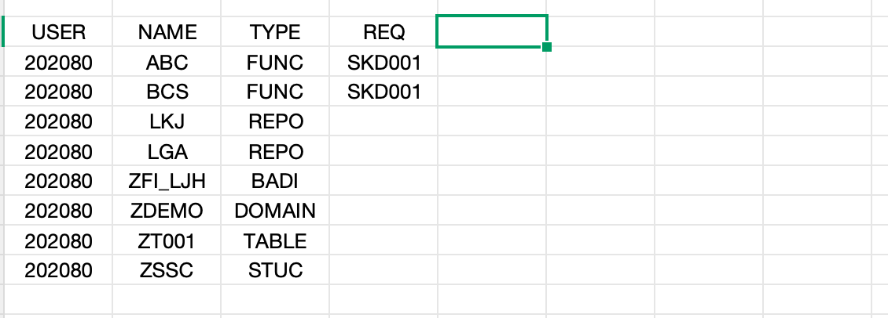

# ZTRH · Developer Transport Handover List

> Transaction **`ZTRH`** ｜ Program **`ZTR_DEVELOPER_HANDOVER`** ｜ ALV structure **`ZTR_DEVELOPER_ALV`**

[中文](README.cn.md) ｜ **English**

Flattens every **transport request (request / task)** owned by a developer together with the **development objects** it contains (programs, function modules, classes, tables, domains, BAdIs, structures …) into a single list, answering the three questions that are hardest to answer during a handover:

1. What exactly did this person change in this system?
2. Which requests is all of it scattered across?
3. Which package does each object belong to, and when was it last touched?

---

## 1. Why this report exists (background)

- On long-running projects, **changed code gets forgotten**, and nobody remembers which program or function module the actual logic ended up in.
- But SAP transport requests **are almost never deleted** — they are a naturally trustworthy, complete, timestamped "change ledger".
- What is missing for handovers, audits and regression hunts is not the data but **an entry point that turns that ledger inside out per developer**.

Hence the approach: **use the TR as the backbone, index the objects backwards, and aggregate by developer (`AS4USER`).**

## 2. Feature overview

- One SELECT spanning `E070 → E071 → TADIR ← E07T` to fetch request header plus object details in a single pass.
- `SALV` output: optimised column widths, striped pattern, all standard toolbar functions, row/column selection.
- By default restricted to the **currently logged-on user** (`sy-uname`); sortable, filterable and exportable — good enough to attach to a handover document as-is.

## 3. Created objects


| Type                   | Name                     | Description                                           |
| ------------------------ | -------------------------- | ------------------------------------------------------- |
| Transaction            | `ZTRH`                   | Report entry point                                    |
| Program                | `ZTR_DEVELOPER_HANDOVER` | Developer transport handover list (executable report) |
| Structure / table type | `ZTR_DEVELOPER_ALV`      | ALV output structure for the handover list            |

## 4. ALV output structure


| Field      | Type                        | Description                                              | Source                                   |
| ------------ | ----------------------------- | ---------------------------------------------------------- | ------------------------------------------ |
| `TRUSER`   | `TRUSER`                    | Owner of the request/task                                | `E070-AS4USER`                           |
| `TRKORR`   | `TRKORR`                    | Request/task                                             | `E070-TRKORR`                            |
| `AS4TEXT`  | `TRORDERTXT`                | Short description of the request                         | `E07T-AS4TEXT` (with `LANGU = sy-langu`) |
| `AS4DATE`  | `TRDATE`                    | Last changed on                                          | `E070-AS4DATE`                           |
| `AS4TIME`  | `AS4TIME`                   | Last changed at                                          | `E070-AS4TIME`                           |
| `DEVCLASS` | `DEVCLASS`                  | Package                                                  | `TADIR-DEVCLASS`                         |
| `OBJECT`   | `TROBJTYPE`                 | Object type                                              | `E071-OBJECT`                            |
| `OBJ_NAME` | `TROBJ_NAME_WITH_LOWERCASE` | Object name in the object list                           | `E071-OBJ_NAME`                          |
| `OBJFUNC`  | `OBJFUNC`                   | Object function (`K` lock / `D` delete / blank = change) | `E071-OBJFUNC`                           |
| `PGMID`    | `PGMID`                     | Program ID in requests and tasks (`R3TR` / `LIMU`)       | `E071-PGMID`                             |

> The structure field names and the SELECT aliases **must match one-to-one**, because v0.1 uses `MOVE-CORRESPONDING` — any mismatch **silently drops the field** without an error. This is the easiest trap to fall into in this project.

## 5. Data retrieval logic and gotchas

```text
E070 (request header / owner)  ──INNER──  E071 (objects in the request)
                                     └──INNER──  TADIR (object → package DEVCLASS, same PGMID/OBJECT/OBJ_NAME)
E07T (request text, per language)  ──LEFT───  E070
WHERE E070-AS4USER = sy-uname
```

- **`E07T` is a LEFT JOIN with `LANGU = @sy-langu`**: a missing description must not drop the whole request row. It can still leave `AS4TEXT` empty, so fall back to any language or show a placeholder in the ALV when needed.
- **`TADIR` is an INNER JOIN**: you get `DEVCLASS`, but you **lose objects that are not in TADIR** (some system objects, cross-system artefacts). If completeness wins, switch to a LEFT JOIN or drive the query from `E071`.
- **`E070` holds both requests and tasks**: objects belonging to tasks of the same request show up as well, so sort/group by `TRKORR` to avoid misreading.
- **No status/type filtering yet**: `E070-TRSTATUS` (e.g. `D` modifiable / `R` released) and `TRFUNCTION` are not part of the output; v0.2 plans to add them (see roadmap).
- **Authorisation**: querying other users' requests requires the appropriate CTS authorisations, otherwise the result is empty or incomplete.

## 6. Screen reference

Requirement analysis sketch (user → object type → owning request, taken from the design-phase analysis sheet):



Target ALV layout: **request header information + object details** flattened into one sortable, exportable list, with multiple object rows of the same request grouped by `TRKORR`.

## 7. Standard program analysis: `TR_PRESENT_REQUESTS_ORGANIZER` / `RDDM0001`

**Observed behaviour**

- Opening the program in `SE38` shows **no event blocks at all** (no `START-OF-SELECTION` and friends).
- Pressing **Execute does nothing**.
- But entering the transaction code brings up the screen just fine.

**Inferred cause (still to be verified in the system)**

- Such programs are not self-contained executable reports (type 1 `REPORT ...`) but **transaction + screen driven programs**: the logic hangs off the screen's `PBO / PAI` (module pool), or the transaction entry point invokes its screen directly.
- `SE38` "Execute" triggers **report events** (`INITIALIZATION` → `START-OF-SELECTION` → …). With no event blocks there is simply nothing to run; the transaction takes a **different entry point** straight into the screen, which makes it look "perfectly normal".

**Takeaway for this project**

- For a report with a selection screen, just use a standard `SELECTION-SCREEN` + `START-OF-SELECTION`. **Do not imitate** this "no events + transaction driven" style.
- To reuse such standard programs you can only `CALL TRANSACTION` — do not expect to call them like a function or subroutine.

References: [SAP Program RDDM0001](https://www.stechno.net/repository/sap-programs.html?id=RDDM0001), [SE09 vs SE10 discussion](https://community.sap.com/t5/application-development-and-automation-discussions/se09-vs-se10/td-p/3564843)

## 8. Requirement analysis: how to display many requests for one user?

The design phase used this small table to sort out the "user → object → request" relationship (same source: `开发传输变更交接清单.xlsx`, sheet `交接程序逻辑分析`):


| USER   | NAME    | TYPE   | REQ    |
| -------- | --------- | -------- | -------- |
| 202080 | ABC     | FUNC   | SKD001 |
| 202080 | BCS     | FUNC   | SKD001 |
| 202080 | LKJ     | REPO   |        |
| 202080 | LGA     | REPO   |        |
| 202080 | ZFI_LJH | BADI   |        |
| 202080 | ZDEMO   | DOMAIN |        |
| 202080 | ZT001   | TABLE  |        |
| 202080 | ZSSC    | STUC   |        |

Three viable display options:


| Option                        | Approach                                                             | Pros                                                                        | Cons                                                                           |
| ------------------------------- | ---------------------------------------------------------------------- | ----------------------------------------------------------------------------- | -------------------------------------------------------------------------------- |
| **A. Flat single ALV (v0.1)** | One row per request × object                                        | Simplest to build; sorting / filtering / export / totals come free with ALV | The same request repeats across rows; readability relies on sorting by`TRKORR` |
| **B. Hierarchical ALV**       | `CL_SALV_TREE`: request as parent node, objects as children          | Clear hierarchy, one parent row per request                                 | Cannot use the`CL_SALV_TABLE` factory; roughly double the code                 |
| **C. Two linked ALVs**        | Top: request headers; bottom: object details, linked on double-click | Closest to the look of a standard transaction                               | Two containers, two`factory` calls, most event handling                        |

v0.1 goes with **A**: get "complete and correct data" solid first, upgrade the presentation later.

## 9. Code example (v0.1)

```abap
*&---------------------------------------------------------------------*
*& Report ZTR_DEVELOPER_HANDOVER
*&---------------------------------------------------------------------*
REPORT ztr_developer_handover.

DATA lt_developer_handover TYPE TABLE OF ztr_developer_alv.
DATA ls_developer_handover TYPE ztr_developer_alv.
DATA lo_salv               TYPE REF TO cl_salv_table.

SELECT e070~trkorr,
       e070~as4user   AS truser,
       e070~as4date,
       e070~as4time,
       e07t~as4text,
       e071~pgmid,
       e071~object,
       e071~obj_name,
       e071~objfunc,
       tadir~devclass
  FROM e070
         INNER JOIN
           e071 ON e070~trkorr = e071~trkorr
             INNER JOIN
               tadir ON  e071~pgmid    = tadir~pgmid
                     AND e071~object   = tadir~object
                     AND e071~obj_name = tadir~obj_name
                 LEFT JOIN
                   e07t ON  e070~trkorr = e07t~trkorr
                        AND e07t~langu  = @sy-langu
  INTO TABLE @DATA(lt_e070)
  WHERE as4user = @sy-uname.

MOVE-CORRESPONDING lt_e070 TO lt_developer_handover.

TRY.
    cl_salv_table=>factory( IMPORTING r_salv_table = lo_salv
                            CHANGING  t_table      = lt_developer_handover ).
  CATCH cx_salv_msg.
ENDTRY.

lo_salv->get_columns( )->set_optimize( abap_true ).
lo_salv->get_functions( )->set_all( abap_true ).
lo_salv->get_display_settings( )->set_striped_pattern( abap_true ).
lo_salv->get_selections( )->set_selection_mode( if_salv_c_selection_mode=>row_column ).

lo_salv->display( ).
```

## 10. FAQ

**Q: How do I enable multi-selection in SALV?**

```abap
" Rows only (the most common meaning of multi-select)
lo_salv->get_selections( )->set_selection_mode( if_salv_c_selection_mode=>multiple ).

" Rows and columns selectable (includes cell-level selection; what v0.1 uses)
lo_salv->get_selections( )->set_selection_mode( if_salv_c_selection_mode=>row_column ).

" Single selection / no selection
lo_salv->get_selections( )->set_selection_mode( if_salv_c_selection_mode=>single ).
lo_salv->get_selections( )->set_selection_mode( if_salv_c_selection_mode=>none ).
```

Also remember the toolbar switch that multi-selection users actually need, otherwise they can select but not act on it:

```abap
lo_salv->get_selections( )->set_selection_mode( if_salv_c_selection_mode=>multiple ).
lo_salv->get_functions( )->set_all( abap_true ).   " Select all / deselect all on the toolbar
```

**Q: Why is a field empty after `MOVE-CORRESPONDING`?**
Field names do not match. `MOVE-CORRESPONDING` only moves **identically named** fields and reports nothing, so check the SELECT aliases, the ALV structure field names and their types together.

**Q: Why is `AS4TEXT` sometimes empty?**
`E07T` stores text per language; if no row exists for the current language the field stays empty. Relax the language condition or show a placeholder as needed.

## 11. Roadmap (v0.2+)

- [ ]  Selection screen: user (default `sy-uname`, multi-select / all), date range, package `DEVCLASS`, object type
- [ ]  Add `TRSTATUS` (request status) and `TRFUNCTION` (request/task/copy) columns with filtering
- [ ]  Turn `TADIR` / `E07T` into LEFT JOINs so objects and descriptions never lose rows, and flag "no package / no description"
- [ ]  Upgrade the presentation: hierarchical ALV or linked top/bottom ALVs (options B / C)
- [ ]  One-click Excel export as a handover attachment, optionally sent by e-mail
- [ ]  Multi-perspective summaries: by developer → by package → by object

## 12. Repository layout

```text
ZTRH/
├── README.md                          # English (this file, repo entry point)
├── README.cn.md                       # Chinese
├── ZTR_DEVELOPER_HANDOVER.prog.abap   # report source
├── docs/
│   └── images/
│       └── design-preview.png
└── 开发传输变更交接清单.xlsx           # requirement / logic analysis draft (git-ignored)
```

> If the project later moves to a standard abapGit layout, relocate the source into `src/` (`ztr_developer_handover.prog.abap`, `ztr_developer_alv.tabl.xml`), add `.abapgit.xml`, and update the `README.cn.md` link accordingly.

## 13. Development environment notes

Writing ABAP on macOS with SAP GUI is painful (editor, shortcuts and copy/paste all suffer). Recommendations:

- Use **abapGit** to sync objects locally, edit logic in VS Code (`abapfs` / `abaplint`), and return to the system only for activation and testing;
- or work on a Windows environment via remote desktop with the full SAP GUI.
